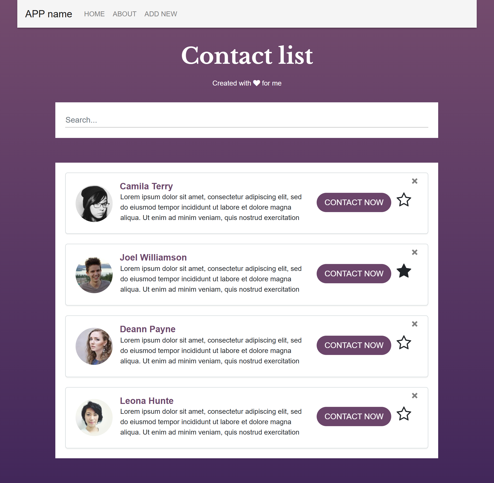
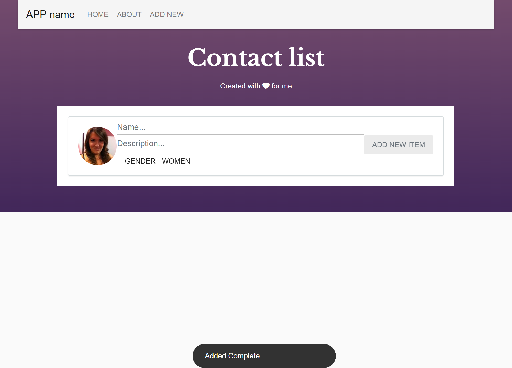

# Contact list — React + Redux (2019)

**[▶ Live demo](https://dimitriuses.github.io/FirstReactProject/)**

[](https://github.com/Dimitriuses/FirstReactProject/actions/workflows/pages.yml)


My first React project, written in September–October 2019: a contact list with search,
add, delete, favourites, a random-avatar toggle and client-side routing.

**It has been serving a blank white page since 8 October 2019.** The last commit removed
three props from `<ContactList />` in order to replace them with a Redux store, and never
finished wiring the store up. Nobody opened the page again. This branch finishes that
migration, and the app runs.



---

## The bug it was abandoned with

The final commit — `reD#x Re*#aDed`, twelve days after the previous one — added Redux and
changed the home route from this:

```jsx
<ContactList
  List={showContacts}
  onFavoriteChange={this.onFavoriteChange}
  onContactDelete={this.onContactDelete}
  onSearch={this.onSearch}
/>
```

to this:

```jsx
<ContactList onSearch={this.onSearch} />
```

The replacement was meant to be `connect()`, in `ContactList.js`. It was left commented
out, one line above the export:

```js
/*const mapStateToProps = (state) =>{ ... }*/

export default  /*connect(mapStateToProps)*/(ContactList);
```

So `List` arrives as `undefined`, `List.map(...)` throws before the first row renders, and
React unmounts the whole tree. The commit was pushed in that state and the repository was
never touched again.

Building `v0.1-original` today and loading it reproduces it exactly — `#root` ends up with
**0 child elements** and four uncaught errors:

```
TypeError: Cannot read properties of undefined (reading 'map')
TypeError: Cannot read properties of undefined (reading 'step')
TypeError: $(...).sortable is not a function
Error: Bootstrap dropdown require Popper.js
```

<table>
<tr><th width="50%"><code>v0.1-original</code> — what was pushed</th><th width="50%">now</th></tr>
<tr><td></td><td></td></tr>
</table>

The Redux code behind the crash never worked either, and could not have. The reducer:

- was given `InitialState.List` (an array) as its default state and then indexed
  `state.List[...]`, which is `undefined` on an array;
- called `this.setState(...)` — a React component method — inside a reducer;
- ended every branch with `break` rather than a `return`, so it returned `undefined` for
  every action **including Redux's own `@@INIT`**, which is what actually sets the store's
  initial state;
- was never reached anyway, because no component was connected and no action was ever
  dispatched.

### Measured, before and after

Three builds, driven through the same scripted 13-checkpoint Playwright session:

| | `v0.1-original` (8 Oct 2019) | last commit that worked (26 Sep 2019) | now |
|---|---|---|---|
| Contacts on the home page | **0 — blank page** | 4 | 4 |
| Session checkpoints reached | 10/13 — *nothing to click* | 13/13 | 13/13 |
| Uncaught errors + console warnings | 8 | 6 | **0** |
| `/about` | never reached | header only, no content | renders |
| Favourite stars | never reached | **inverted** — the one favourite showed hollow | correct |
| Third-party hosts | 9 | 9 | 6 |
| Third-party `<script>` tags | 7 | 7 | **0** |
| Horizontal overflow at 390 px | — | 15 px | **0** |
| Nav links reachable on a phone | 0 | **1 of 6** — only the brand | 4 of 4 |
| Build warnings | 21 | 10 | **0** |
| Tests | none | none | 16 |

The final commit is responsible for eleven of those twenty-one warnings, all of them
pointing straight at the unfinished migration: `connect` imported and unused in two files,
four unused action creators, and the `showContacts` filter still being computed in `App`
and then passed to nobody.

### The tests that pin it

Each of these was watched failing against the 2019 behaviour before being kept — the fix
was reverted, the test run, and the reversion undone:

| Test | Goes red against |
|---|---|
| `ContactList_RenderedFromTheStore_ShowsEveryContact` | the commented-out `connect()` — fails with the identical `Cannot read properties of undefined (reading 'map')` |
| `Reducer_UnknownAction_ReturnsTheStateUnchanged` | `default: break;` — the store initialises to `undefined` and takes four more tests down with it |
| `AddContact_AfterADelete_StillAssignsAnUnusedId` | `id: List.length + 1` — delete one contact, add another, and two rows share an id |
| `ContactList_RendersTheFavoriteStarFilledAndTheRestHollow` | the inverted `favorite ? "fa-star-o" : "fa-star"` ternary |

---

## Status and history

Nine commits between 16 September and 8 October 2019, every one on a weekday morning
between 09:20 and 12:11 — which looks like scheduled sessions rather than evenings and
weekends, though nothing in the repository records what it was for.

| | |
|---|---|
| `8752e24` 16 Sep | `Initial commit from Create React App` (react-scripts 3.1.1) |
| `8586a03` 17 Sep | first components; the CRA sample app deleted |
| `87140f9`, `3031b7f` 18 Sep | list rendering, button state |
| `c0c3736` 24 Sep | search and the add form |
| `aac5607`, `be895ba` 25 Sep | add finished, About page |
| `57dde6c` 26 Sep | `Design++` — **the last commit where the app worked** |
| `e60a1d4` 8 Oct | `reD#x Re*#aDed` — Redux started, props removed, left broken |

The 2019 `README.md` and `.gitignore` were identical to `react-scripts@3.1.1`'s own
templates (line endings aside — the checkout is CRLF), and `robots.txt` and the favicon
still are. Everything under `src/` is hand-written.

The 2019 tree still *compiles* on Node 22 with **one environment variable and no source
change** — `react-scripts` 3 runs on webpack 4, which hashes with md4, and OpenSSL 3
refuses. What it does not do is render anything.

## What changed in 2026

Everything is preserved at the `v0.1-original` tag. The tidy was deliberately narrow: the
visual design, the seed data, the component split and the CSS are the 2019 ones.

**The Redux migration, finished as intended**

- `src/store/` — action creators, a pure reducer, selectors and the seed data.
- The store owns the contact list and the search text. Component state keeps what is
  genuinely local: the half-typed form on *Add New*, and whether a row's button reads
  *Contact Now* or *X*.
- `ContactList`, `ContactListItem`, `Search` and `AddNewItem` are `connect`ed. The App
  component that used to hold the contact list, the search text and five handlers is now
  a `Provider`, a `Router` and four routes — `index.js` went from 157 lines to 38.
- Deleted: the never-called `LIST`/`FAV`/`DEL`/`DOUBLE` action creators and the reducer's
  dead branches.

**Fixed along the way** — each one measured, not assumed

- `<Route path="/about" exact Component={About}/>` — capital `Component`, which React
  Router ignores, so *About* rendered the header and nothing else. Now `component`.
- The favourite star was inverted: `favorite === true` drew `fa-star-o` (hollow).
- New contacts took `id: list.length + 1`, which repeats an id after any delete.
- A stray `)}/>` left in the JSX, silently swallowed because `<Switch>` discards children
  that are not elements.
- 21 build warnings → 0: `class=` instead of `className=`, `tabindex`, missing `alt`,
  unused imports, and the `showContacts` filter that was computed and thrown away.
- Below 992 px the nav links sat behind a hamburger button whose Bootstrap JS was never
  loaded, so they could not be reached at all on a phone; the `.media` rows also ran 15 px
  past a 390 px viewport. Both fixed — 4 of 4 links reachable, 0 px overflow.

 

**The page's `<head>`, which was doing nothing at all**

Seven external `<script>` tags and two inline ones, none of which achieved anything. The
page loaded jQuery 1.11.1 and then jQuery 3.2.1 **slim** over the top of it, Popper *after*
the Bootstrap Material Design bundle that needs it, that bundle twice, jQuery UI, and
SnackbarJS from `cdn.rawgit.com`. Measured: `$('body').bootstrapMaterialDesign()` ran inside
`<head>`, where `$('body')` matches nothing because the body has not been parsed yet — so
Material Design was never initialised, and the DOM contains none of the `bmd-` markers it
adds. jQuery UI then died on `$.fx.step`, because the slim build ships no effects module and
`$.fx` is `undefined`, so `$("#sortable").sortable()` — the drag-to-reorder that the
`cursor: grabbing` rule was there for — threw on every single page load. All of it is gone.
The page now loads **two stylesheets, both SRI-pinned, and no third-party JavaScript**.

The only thing that still did something was the "Added Complete" toast, and it is now
rendered from React state. Keeping SnackbarJS would have meant keeping jQuery **below
3.5** with it: the plugin builds its own container with
`$("body").append("<div id=snackbar-container/>")`, and jQuery 3.5.0 stopped rewriting
self-closing tags (the CVE-2020-11022 fix), so on any current jQuery the id becomes
`snackbar-container/` and the toast is created but never inserted into the page.



## Running it

```bash
nvm use                                  # Node 22 — see .nvmrc
npm ci                                   # 1,458 packages, no native build
export NODE_OPTIONS=--openssl-legacy-provider
npm start                                # http://localhost:3000
npm run build                            # -> build/
```

In PowerShell that middle line is `$env:NODE_OPTIONS="--openssl-legacy-provider"`.

**Both `npm start` and `npm run build` need it**, and neither works without it: react-scripts
3.1.1 builds on webpack 4.39.1, which hashes with md4, and OpenSSL 3 (Node 17+) refuses —
`Error: error:0308010C:digital envelope routines::unsupported`. That single variable is the
entire retarget from 2019 to Node 22; no source file needed changing to make it build. The
GitHub Actions workflow sets the same variable.

## Tests

```bash
npm test -- --watchAll=false
```

```
Test Suites: 2 passed, 2 total
Tests:       16 passed, 16 total
```

`src/store/reducer.test.js` covers the reducer and the search selector;
`src/components/ContactList/ContactList.test.js` renders the connected list against a real
store. There is no test runner beyond the one CRA already ships.

## Layout

```
src/
├── index.js                      Provider + Router + routes
├── index.css                     the 2019 stylesheet, plus one media query
├── store/
│   ├── actions.js                action types and creators
│   ├── reducer.js                pure, immutable
│   ├── selectors.js              the search filter
│   ├── contacts.js               four seed contacts
│   └── reducer.test.js
└── components/
    ├── ContactList/              connected list + its test
    ├── ContactListItem/          one row; dispatches favourite / delete / avatar
    ├── Search/                   connected search box
    ├── AddNewItem/               form draft in local state, dispatches on submit
    ├── Header/                   navbar and title
    ├── About/                    a placeholder, as it was in 2019
    └── NotFound/
```

The 2019 directories were `Componentrs/`, `Reduser/` and `Heder.css`; the spellings are
fixed. The moves were made with `git mv`, but most of these files were also rewritten in
the same pass, so Git's similarity detection records them as delete-plus-add rather than as
renames — only `NotFound.js` survives as a true rename. **`v0.1-original` is the reliable
way back**, not `git log --follow`.

## Known limitations

- **Nothing is persisted.** Reload the page and the four seed contacts are back. There is
  no backend, no `localStorage`, and adding one was out of scope for this pass.
- **The *About* page contains the word "About" and nothing else.** That is what 2019 wrote,
  and inventing content for it would misrepresent the project.
- **The avatars come from `randomuser.me`**, one request per contact, so the demo needs
  network access and depends on that service staying up. The gender/index pair is the only
  thing the app stores.
- **No drag-to-reorder.** The 2019 page tried to add it with jQuery UI and never
  succeeded; rather than bolt jQuery onto a React app, the dead code was removed.
- **The toolchain is period-accurate, not current.** react-scripts 3.1.1 is unmaintained
  and `npm audit` reports 229 advisories against it — 23 critical. None of them name a
  runtime dependency: they are in webpack 4, Babel, ESLint, Jest and `webpack-dev-server`,
  which never reach the browser. Migrating to Vite would clear them and was deliberately
  not done, because it would replace the toolchain this project is a record of.
- **The Redux here is pre-Redux-Toolkit**, written the way the 2019 course taught it —
  hand-rolled action types, a switch reducer, `connect`. That is period-typical, not a
  defect.
- **No test covers the components' click handlers**; the tests cover the store and the
  connected list's rendering.

## Licence

MIT — see [LICENSE](LICENSE). Third-party resources loaded at runtime are listed in
[NOTICE.md](NOTICE.md).
